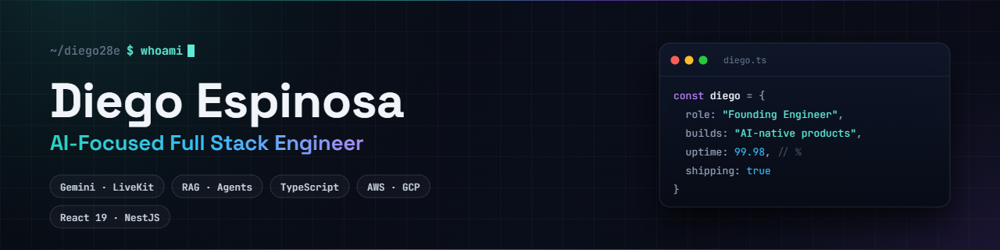

  

  

  
  
  
  
  

---

## 👋 Hey, I'm Diego

I'm an **AI-focused full stack engineer** based in Medellín, Colombia. For the last **6 years** I've been the **founding engineer** of a language-learning platform — building every system from a blank slate and keeping it online at **99.98% uptime**. These days most of my time goes into shipping **AI-native features that change how a product actually works**: AI tutors you can talk to, voice agents, RAG pipelines, and AI-generated content that's verified before anyone sees it — core capabilities, not bolt-ons.

- 🔭 &nbsp;**Currently** — Lead Engineer @ Idiomas OCW, building an AI-native LMS (NestJS · React 19 · AWS CDK)
- 🛠️ &nbsp;**Also building** — [Academia del Código](https://academiadelcodigo.com/), an AI learning platform for LLM engineering, and [Learning Kit](https://github.com/intellectif/learning-kit), an open-source learning SDK on npm that powers both platforms
- 🤖 &nbsp;**I love** — turning LLMs (Gemini, Claude, OpenAI) into real product features with LiveKit, ElevenLabs, Deepgram & pgvector
- 💬 &nbsp;**Ask me about** — AI integration, real-time voice tutors, AWS architecture, and shipping fast as a small team
- 📫 &nbsp;**Reach me** — diego28e@gmail.com · [LinkedIn](https://www.linkedin.com/in/diego28e/)

---

## 🚀 Featured Projects

<table>
  <tr>
    <td>
      <h3>🧠 Academia del Código — AI learning platform for LLM engineering — production · open code</h3>
      
A bilingual platform that teaches developers to build LLM applications with LangChain &amp; LangGraph: a 129-lesson course where every lesson opens a <b>runnable Jupyter notebook</b> in the learner's own lab (JupyterHub), an <b>AI tutor learners can talk to</b> (streaming speech in and out), and <b>adaptive daily practice</b> — FSRS spaced repetition over a 700+ skill prerequisite graph. Its AI-written exercises are <b>proven before any learner sees them</b>: code tasks run in a gVisor sandbox (the reference must pass, a wrong version must fail), questions are answered blind by a second model, and failures are repaired from the sandbox's real output. Long jobs run on a Postgres-backed worker beyond serverless limits; videos flow through S3, MediaConvert and signed CloudFront URLs with English &amp; Spanish captions generated automatically.

      

        
        
        
        
        
        
        
        
        
      

      <a href="https://academiadelcodigo.com/"><b>Live →</b></a> &nbsp;·&nbsp; <a href="https://github.com/diego28e/script-playground"><b>Code →</b></a>
    </td>
  </tr>
  <tr>
    <td>
      <h3>🎓 Idiomas OCW — AI-Native Language Learning LMS — flagship · production</h3>
      
A full multilingual LMS built end-to-end: self-paced courses, Stripe billing, and BigBlueButton live classrooms. Ships a <b>real-time AI Voice Tutor</b> via Gemini Live + LiveKit with server-controlled session timing, long-term memory via Zep, and a BullMQ-driven automated evaluation pipeline. Includes multimodal <b>WhatsApp AI agents</b> (sales + support) using Gemini 2.5 Flash with function-calling for live pricing, OGG voice-note transcription, and pgvector-backed RAG. An automated micro-lesson pipeline parses diarized ElevenLabs class transcripts to extract vocabulary and schedules timezone-aware WhatsApp practice sessions. Deployed on a cost-conscious single-stack AWS CDK infrastructure with zero-downtime blue-green Docker deployments behind Caddy, monitored via CloudWatch + SNS.

      

        
        
        
        
        
        
        
        
        
      

      <a href="https://www.onecultureworld.com"><b>Live →</b></a>
    </td>
  </tr>
  <tr>
    <td>
      <h3>📦 Learning Kit — open-source SDK for interactive learning — npm · MIT</h3>
      
A <b>TypeScript-first SDK for interactive educational content</b> — a lightweight, schema-driven alternative to H5P, published on npm as five packages and running in production in both platforms above. <b>lk-core</b>: schemas, a deterministic scoring engine, rubric grading and an xAPI 1.0.3 builder, with no runtime dependencies beyond Zod. <b>lk-react</b>: accessible React 19 components (WCAG 2.2 AA), interactive video included. <b>lk-practice</b>: spaced-practice planning over a skill graph — FSRS-7 memory, Elo ability and stage ladders as pure functions of a replayable log. Plus <b>lk-azure</b> (pronunciation assessment) and <b>lk-interactive-activities</b>.

      

        
        
        
        
        
        
        
      

      <a href="https://github.com/intellectif/learning-kit"><b>Code →</b></a> &nbsp;·&nbsp; <a href="https://www.npmjs.com/package/@intellectif/lk-core"><b>npm →</b></a>
    </td>
  </tr>
</table>

### More I've built

<table>
  <tr>
    <td width="50%">
      <h4>🗣️ Polyglotas — production</h4>
      
An AI language-learning platform: <b>dictation</b>, <b>pronunciation assessment with phoneme-level feedback</b>, and <b>spontaneous AI conversation</b>, orchestrating AWS, Google Cloud &amp; Azure.

      <a href="https://polyglotas.com/"><b>Live →</b></a>
    </td>
    <td width="50%">
      <h4>🎬 Cinematic GenAI Video Pipeline — GPU</h4>
      
A GPU-backed FastAPI service on GCP that turns a scene script into a ~5-minute video with consistent recurring characters, narrated with ElevenLabs and delivered through S3 and CloudFront.

      <a href="https://github.com/diego28e/ai-video-generation-pipeline"><b>Code →</b></a>
    </td>
  </tr>
</table>

---

## 🛠️ Tech I build with

**AI & ML**

**Languages & Frontend**

**Backend & Data**

**Cloud & DevOps**

---

## 📊 GitHub Stats

  
  

  

---

  <i>Building AI features that change how a product works — let's talk.</i> 
  <b><a href="mailto:diego28e@gmail.com">diego28e@gmail.com</a></b>

<!---
diego28e/diego28e is a ✨ special ✨ repository because its `README.md` (this file) appears on your GitHub profile.
--->
